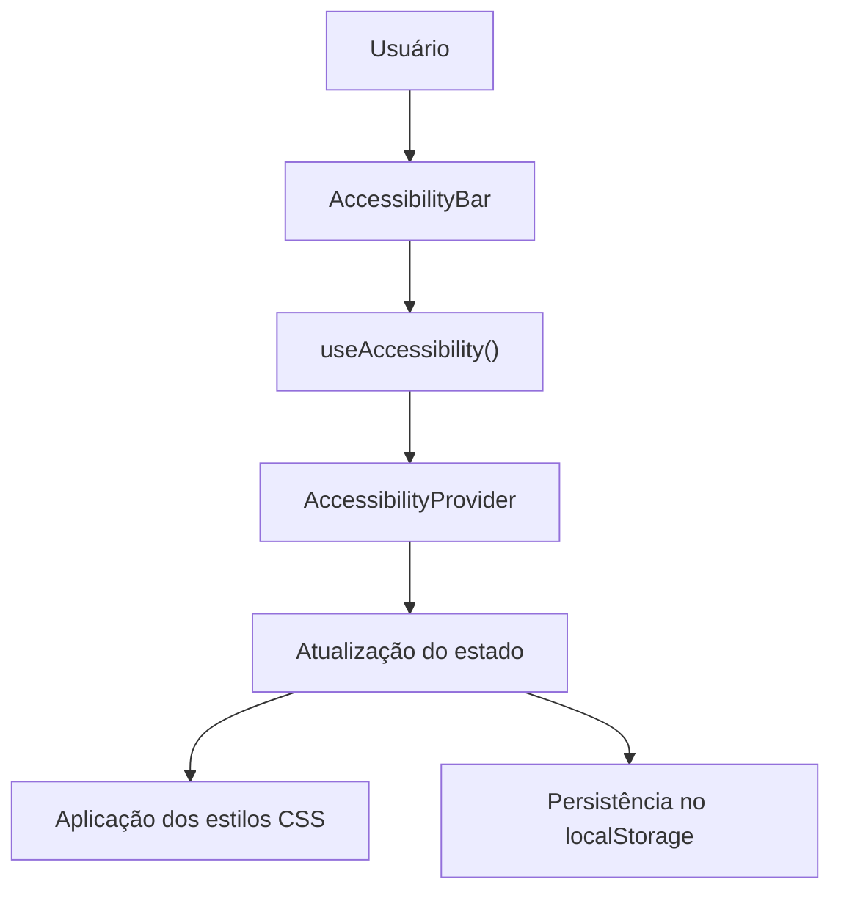
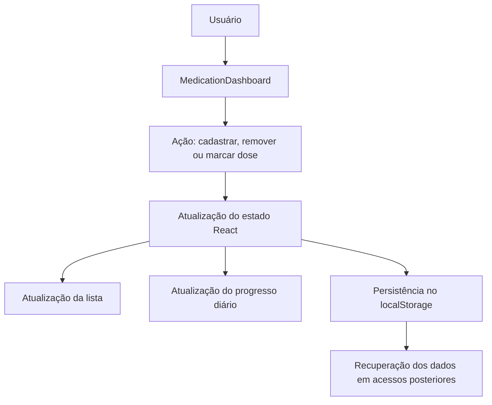
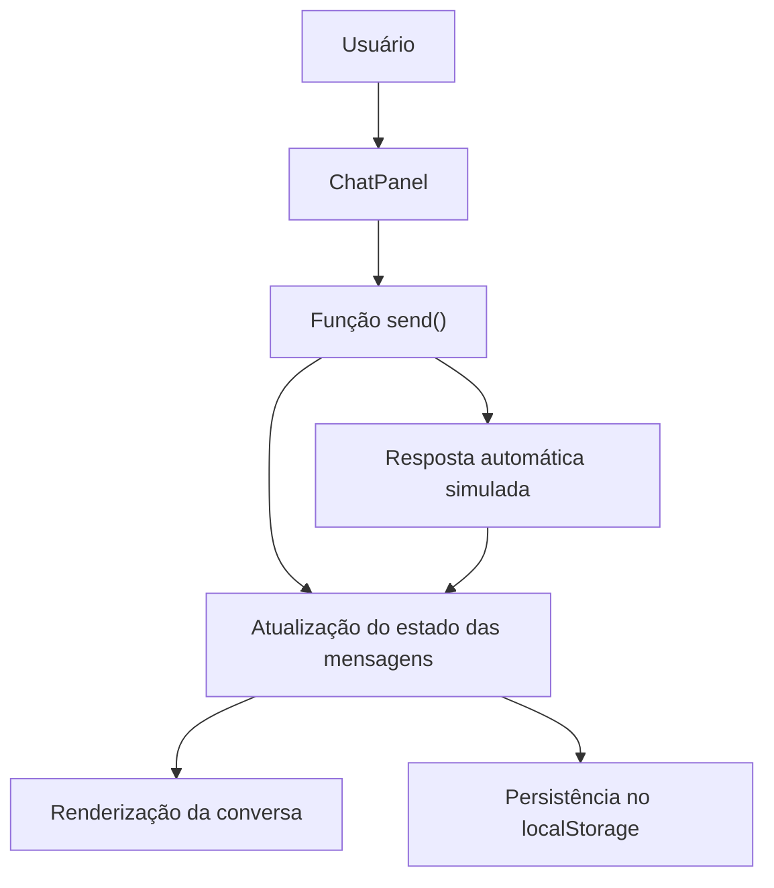

# ElderCare — Arquitetura e Componentes da Aplicação

## 1. Visão geral

O **ElderCare** é uma aplicação web desenvolvida com Next.js e React, voltada ao apoio de idosos e cuidadores. A aplicação reúne funcionalidades para gerenciamento de medicamentos, acessibilidade, localização de serviços de saúde e assistência, além de um chat demonstrativo.

Este documento apresenta a estrutura dos componentes, suas responsabilidades, o fluxo de navegação e a comunicação entre os elementos da aplicação.

## 2. Estrutura de diretórios

```text
eldercare-next/
├── src/
│   ├── app/
│   │   ├── layout.tsx
│   │   ├── page.tsx
│   │   ├── mapa/
│   │   │   └── page.tsx
│   │   ├── cuidador/
│   │   │   └── page.tsx
│   │   ├── globals.css
│   │   └── not-found.tsx
│   │
│   ├── components/
│   │   ├── AppShell.tsx
│   │   ├── Sidebar.tsx
│   │   ├── AccessibilityBar.tsx
│   │   ├── AccessibilityProvider.tsx
│   │   ├── MedicationDashboard.tsx
│   │   └── ChatPanel.tsx
│   │
│   └── lib/
│
├── package.json
├── next.config.ts
├── eslint.config.mjs
├── tsconfig.json
└── README.md
```

## 3. Componentes da aplicação

### 3.1. `layout.tsx`

**Localização:** `src/app/layout.tsx`

É o layout raiz da aplicação. Define a estrutura global que envolve as páginas, os metadados e o idioma do documento.

Responsabilidades:
- Importar os estilos globais.
- Definir os metadados da aplicação.
- Configurar o idioma como português do Brasil (`pt-BR`).
- Envolver a aplicação com o `AccessibilityProvider`.
- Renderizar o `AppShell`, responsável pela estrutura visual compartilhada.

### 3.2. `AppShell.tsx`

**Localização:** `src/components/AppShell.tsx`

É responsável por organizar os elementos visuais comuns às páginas.

Responsabilidades:
- Renderizar a barra de acessibilidade.
- Renderizar o menu lateral.
- Disponibilizar a área principal de conteúdo por meio de `children`.
- Manter uma estrutura consistente durante a navegação.

Componentes utilizados:
- `AccessibilityBar`
- `Sidebar`

### 3.3. `Sidebar.tsx`

**Localização:** `src/components/Sidebar.tsx`

Implementa o menu lateral de navegação.

Responsabilidades:
- Disponibilizar links para as páginas da aplicação.
- Permitir a navegação entre as rotas.
- Identificar a rota atual utilizando `usePathname`.
- Aplicar um estilo visual à opção de navegação ativa.

Rotas disponíveis:

| Rota | Página |
|---|---|
| `/` | Painel de medicamentos |
| `/mapa` | Localização de serviços |
| `/cuidador` | Área do cuidador |

A navegação utiliza os recursos de roteamento do Next.js.

### 3.4. `AccessibilityBar.tsx`

**Localização:** `src/components/AccessibilityBar.tsx`

Disponibiliza controles de acessibilidade visual.

Responsabilidades:
- Aumentar o tamanho da fonte.
- Diminuir o tamanho da fonte.
- Restaurar o tamanho padrão da fonte.
- Ativar ou desativar o alto contraste.

O componente utiliza o hook `useAccessibility()` para acessar o estado compartilhado pelo `AccessibilityProvider`.

### 3.5. `AccessibilityProvider.tsx`

**Localização:** `src/components/AccessibilityProvider.tsx`

Implementa o contexto React responsável pelo compartilhamento das preferências de acessibilidade.

Responsabilidades:
- Gerenciar o tamanho da fonte.
- Gerenciar o modo de alto contraste.
- Disponibilizar as preferências por meio da Context API.
- Persistir as configurações no `localStorage`.
- Aplicar as configurações à interface utilizando variáveis e classes CSS.

O componente exporta o hook `useAccessibility()`, utilizado por outros componentes para consultar e modificar as preferências.

### 3.6. `MedicationDashboard.tsx`

**Localização:** `src/components/MedicationDashboard.tsx`

É o principal componente funcional da página inicial.

Responsabilidades:
- Exibir a lista de medicamentos.
- Permitir o cadastro de medicamentos.
- Permitir a remoção de medicamentos.
- Registrar medicamentos como tomados.
- Organizar os medicamentos por horário.
- Calcular e exibir o progresso diário.
- Persistir os dados no `localStorage`.
- Realizar o controle de reinicialização diária dos registros.
- Incorporar o componente `ChatPanel`.

O componente utiliza o estado do React, por meio de `useState`, para atualizar a interface quando os dados são alterados.

### 3.7. `ChatPanel.tsx`

**Localização:** `src/components/ChatPanel.tsx`

Implementa uma interface de conversa demonstrativa, reutilizada no painel de medicamentos e na área do cuidador.

Responsabilidades:
- Exibir o histórico de mensagens.
- Permitir o envio de mensagens.
- Disponibilizar respostas rápidas.
- Gerar respostas automáticas demonstrativas.
- Persistir o histórico no `localStorage`.

A conversa é armazenada localmente no navegador.

**Limitação:** o chat não possui integração com um serviço externo de mensagens. As respostas são simuladas e não são enviadas a uma pessoa real.

### 3.8. `app/page.tsx`

**Localização:** `src/app/page.tsx`

Representa a página inicial da aplicação, acessível pela rota `/`.

Sua responsabilidade é renderizar o componente `MedicationDashboard`, que concentra as funcionalidades de gerenciamento de medicamentos.

### 3.9. `app/mapa/page.tsx`

**Localização:** `src/app/mapa/page.tsx`

Apresenta opções para localizar serviços de saúde e assistência social.

Responsabilidades:
- Disponibilizar categorias como UBS, hospitais, CRAS e centros de convivência.
- Direcionar o usuário para pesquisas no Google Maps.
- Disponibilizar atalhos telefônicos para serviços de emergência e proteção.

A página utiliza links externos e informações estáticas. Não há integração com uma base própria de estabelecimentos nem confirmação de disponibilidade dos serviços.

### 3.10. `app/cuidador/page.tsx`

**Localização:** `src/app/cuidador/page.tsx`

Apresenta informações e orientações destinadas aos cuidadores.

Responsabilidades:
- Exibir orientações para o cuidado.
- Apresentar informações demonstrativas de perfil.
- Disponibilizar links para recursos externos, incluindo informações governamentais.
- Reutilizar o componente `ChatPanel`.

As informações de perfil são demonstrativas e não representam, por si só, um sistema de autenticação ou gerenciamento de usuários.

### 3.11. `globals.css`

**Localização:** `src/app/globals.css`

Define os estilos globais da aplicação.

Responsabilidades:
- Definir cores e tipografia.
- Organizar o layout dos componentes.
- Definir estilos para elementos e classes da interface.
- Implementar ajustes de acessibilidade visual.
- Contribuir para a responsividade da aplicação.

### 3.12. `not-found.tsx`

**Localização:** `src/app/not-found.tsx`

Define a interface apresentada quando o usuário acessa uma rota inexistente.

## 4. Fluxo de ligação entre os componentes

O fluxo geral da aplicação pode ser representado da seguinte maneira:

```mermaid
flowchart TD
    A["layout.tsx"] --> B["AccessibilityProvider"]
    B --> C["AppShell"]

    C --> D["AccessibilityBar"]
    C --> E["Sidebar"]
    C --> F["Área principal (main)"]

    F --> G["page.tsx — Medicação"]
    F --> H["mapa/page.tsx — Mapa"]
    F --> I["cuidador/page.tsx — Cuidador"]

    G --> J["MedicationDashboard"]
    J --> K["ChatPanel"]
    I --> K

    D --> B
    E --> L["Next.js Router"]
    L --> G
    L --> H
    L --> I
```



### Descrição do fluxo

1. O `layout.tsx` estabelece a estrutura global da aplicação.
2. O `AccessibilityProvider` disponibiliza o estado compartilhado das preferências de acessibilidade.
3. O `AppShell` organiza a barra de acessibilidade, o menu lateral e a área principal.
4. O `Sidebar` permite ao usuário selecionar uma página.
5. O roteador do Next.js identifica a rota solicitada e renderiza a página correspondente.
6. Na rota `/`, o `MedicationDashboard` gerencia os medicamentos e incorpora o `ChatPanel`.
7. Na rota `/mapa`, é renderizada a interface de localização de serviços.
8. Na rota `/cuidador`, são exibidas as orientações para cuidadores e o `ChatPanel`.

## 5. Fluxos de interação

### 5.1. Fluxo de acessibilidade



Funcionamento:

1. O usuário seleciona uma opção de acessibilidade.
2. A `AccessibilityBar` chama a função correspondente disponibilizada pelo contexto.
3. O `AccessibilityProvider` atualiza o estado.
4. A interface reflete a nova configuração.
5. As preferências são armazenadas localmente para uso posterior.

### 5.2. Fluxo de gerenciamento de medicamentos



Funcionamento:

1. O usuário executa uma ação sobre um medicamento.
2. O `MedicationDashboard` atualiza o estado utilizando `useState`.
3. A interface é renderizada novamente com os dados atualizados.
4. O progresso diário é recalculado.
5. O `localStorage` mantém os dados no navegador.

O componente também utiliza informações de data para controlar a reinicialização diária dos registros.

### 5.3. Fluxo do chat



Funcionamento:

1. O usuário envia uma mensagem ou seleciona uma resposta rápida.
2. A função `send()` processa a interação.
3. O estado das mensagens é atualizado.
4. A conversa é renderizada novamente.
5. O histórico é persistido no navegador.
6. Quando aplicável, uma resposta automática demonstrativa é adicionada à conversa.

Esse fluxo não envolve comunicação com uma pessoa real nem processamento por um backend.

## 6. Navegação entre páginas

| URL | Componente de página | Finalidade |
|---|---|---|
| `/` | `app/page.tsx` | Gerenciamento de medicamentos |
| `/mapa` | `app/mapa/page.tsx` | Localização de serviços |
| `/cuidador` | `app/cuidador/page.tsx` | Orientações para cuidadores |

O `Sidebar` utiliza os recursos de navegação do Next.js para permitir a mudança entre as páginas. O `usePathname` permite identificar a rota atual e destacar o item correspondente no menu.

O layout compartilhado mantém a barra de acessibilidade e a navegação consistentes entre as páginas.

## 7. Comunicação e gerenciamento de dados

A aplicação utiliza três mecanismos principais para organizar e manter os dados.

### 7.1. Props

As props permitem que componentes recebam informações e elementos de outros componentes.

Um exemplo é a propriedade `children` utilizada pelo `AppShell` para renderizar o conteúdo da página atual.

### 7.2. Context API

A Context API é utilizada para compartilhar as preferências de acessibilidade sem exigir que cada componente receba essas informações individualmente por props.

O `AccessibilityProvider` centraliza esse estado, enquanto a `AccessibilityBar` acessa as funções por meio do hook `useAccessibility()`.

### 7.3. Estado React e `localStorage`

O estado React controla os dados utilizados durante a interação com a interface. O `localStorage` permite persistir informações no navegador.

| Dados | Gerenciamento | Persistência |
|---|---|---|
| Preferências de acessibilidade | `AccessibilityProvider` | `localStorage` |
| Lista de medicamentos | `MedicationDashboard` | `localStorage` |
| Histórico do chat | `ChatPanel` | `localStorage` |

O armazenamento local não equivale a um banco de dados centralizado. Os dados ficam associados ao navegador utilizado e não são sincronizados automaticamente entre dispositivos ou usuários.

## 8. Dependências entre componentes

| Componente | Dependências principais |
|---|---|
| `layout.tsx` | `AccessibilityProvider`, `AppShell` |
| `AppShell.tsx` | `AccessibilityBar`, `Sidebar` |
| `AccessibilityBar.tsx` | `AccessibilityProvider`, hook `useAccessibility()` |
| `AccessibilityProvider.tsx` | React Context, estado React e `localStorage` |
| `Sidebar.tsx` | Recursos de navegação do Next.js |
| `app/page.tsx` | `MedicationDashboard` |
| `MedicationDashboard.tsx` | Estado React, `localStorage`, `ChatPanel` |
| `ChatPanel.tsx` | Estado React e `localStorage` |
| `app/mapa/page.tsx` | Conteúdo estático, links externos e links telefônicos |
| `app/cuidador/page.tsx` | Conteúdo informativo, links externos e `ChatPanel` |
| `globals.css` | Elementos, classes e variáveis CSS da aplicação |
| `not-found.tsx` | Estrutura de página de erro |

## 9. Limitações atuais e possibilidades de evolução

A arquitetura atual é adequada para uma demonstração de interface, mas algumas funcionalidades podem ser ampliadas.

### Limitações atuais

- Não há backend centralizado para os dados de medicamentos.
- Não existe sincronização automática entre dispositivos.
- O chat é demonstrativo e não permite comunicação real.
- A localização de serviços depende de pesquisas externas e não de uma base própria validada.
- Os dados de perfil apresentados são demonstrativos.
- O armazenamento local não substitui autenticação, controle de acesso ou banco de dados.

### Melhorias futuras

- Criar uma API para gerenciamento de medicamentos e usuários.
- Implementar autenticação e controle de permissões.
- Integrar o chat a um serviço real de comunicação.
- Utilizar uma fonte confiável de dados para localizar serviços de saúde.
- Criar módulos específicos em `src/lib/` para centralizar regras de negócio e integrações.
- Implementar sincronização e cópias de segurança dos dados.

## 10. Conclusão

A aplicação ElderCare utiliza uma arquitetura baseada em componentes reutilizáveis do React e no sistema de rotas do Next.js.

O `layout.tsx` define a estrutura global, o `AppShell` organiza a interface compartilhada e o roteador direciona o usuário para a página correspondente. Os componentes funcionais implementam o gerenciamento de medicamentos, as preferências de acessibilidade e o chat demonstrativo.

A comunicação interna ocorre principalmente por meio de props, Context API e estado React. A persistência é realizada com `localStorage`, sem um backend centralizado na implementação atual.

Essa separação de responsabilidades facilita a manutenção do código e permite evoluir a aplicação gradualmente, incorporando serviços externos, APIs e persistência centralizada conforme as necessidades do projeto.
