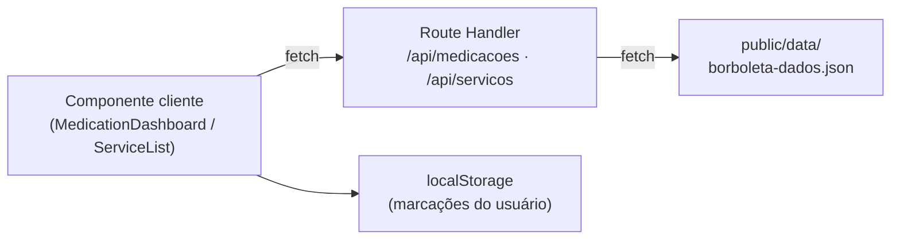

# ElderCare — Servidor × Cliente, Rotas e API com `fetch`

Documento complementar ao `Check-in2.md`. Define quais partes da aplicação são executadas no **servidor** e quais no **cliente**, lista as **rotas** e propõe uma **API** que consome o JSON de dados usando `fetch`.

> **Observações sobre a fonte**
> - O `Check-in2.md` não indica `"use client"` explicitamente. A classificação da seção 1 foi inferida pelo que cada arquivo usa (hooks, `localStorage`, `metadata`), conforme a regra do App Router do Next.js.
> - O `Check-in2.md` não define como o JSON é consumido: apenas lista "criar uma API" como melhoria futura. A seção 3 é uma **proposta** deste documento.

---

## 1. Responsabilidades: Servidor × Cliente

No App Router do Next.js, todo componente é **Server Component** por padrão. Apenas os componentes que usam estado, hooks ou APIs do navegador precisam de `"use client"`.

| Arquivo | Lado | Justificativa |
|---|---|---|
| `layout.tsx` | Servidor | Exporta `metadata` e define `lang="pt-BR"`, o que não funciona em componente cliente. |
| `AppShell.tsx` | Servidor | Apenas organiza a estrutura e recebe `children`, sem estado nem hooks. |
| `app/page.tsx` | Servidor | Apenas renderiza o `MedicationDashboard`. |
| `app/mapa/page.tsx` | Servidor | Conteúdo estático, links do Google Maps e `tel:`. |
| `app/cuidador/page.tsx` | Servidor | Texto e links; apenas inclui o `ChatPanel`. |
| `not-found.tsx` | Servidor | Página 404 estática. |
| `globals.css` | Estático | Estilos, sem execução. |
| `AccessibilityProvider.tsx` | **Cliente** | Context API, `useState` e `localStorage`. |
| `AccessibilityBar.tsx` | **Cliente** | Usa `useAccessibility()` e eventos de clique. |
| `Sidebar.tsx` | **Cliente** | Usa `usePathname` para destacar a rota ativa. |
| `MedicationDashboard.tsx` | **Cliente** | `useState`, `localStorage`, reset diário, progresso e `fetch`. |
| `ChatPanel.tsx` | **Cliente** | Estado das mensagens, `localStorage` e respostas simuladas. |
| `ServiceList.tsx` *(novo)* | **Cliente** | Filtros com `useState` e `fetch` em `useEffect`. |

Os componentes de cliente precisam de `"use client"` na primeira linha do arquivo.

### Resumo da divisão

| Lado | Responsabilidade |
|---|---|
| **Servidor** | Montar a estrutura (layout, shell, páginas), definir metadados e idioma, servir o JSON e responder às rotas de API. |
| **Cliente** | Tudo que reage a clique, estado ou navegador: acessibilidade, navegação ativa, medicamentos, chat, filtros e chamadas `fetch`. |

No `Check-in2.md` o servidor não executa lógica de negócio nem guarda dados: tudo é persistido no `localStorage` do navegador.

---

## 2. Rotas

### 2.1. Páginas (existentes no Check-in2)

| Rota | Arquivo | Finalidade |
|---|---|---|
| `/` | `app/page.tsx` | Painel de medicamentos (com chat) |
| `/mapa` | `app/mapa/page.tsx` | Localização de serviços e telefones de emergência |
| `/cuidador` | `app/cuidador/page.tsx` | Orientações ao cuidador (com chat) |
| qualquer outra | `app/not-found.tsx` | Erro 404 |

### 2.2. Rotas de API (propostas)

| Rota | Método | Retorna | Consumida por |
|---|---|---|---|
| `/api/medicacoes` | GET | Lista inicial de medicamentos | `MedicationDashboard` |
| `/api/servicos?tipo=ubs&bairro=Centro` | GET | Serviços filtrados por tipo e bairro | `ServiceList` |

---

## 3. API para consumir o JSON com `fetch`

### 3.1. Estrutura de arquivos

O JSON fica em `public/data/`, para ser servido como arquivo estático e acessível por `fetch`.

```text
public/
└── data/
    └── borboleta-dados.json        → acessível em /data/borboleta-dados.json
src/
├── app/
│   └── api/
│       ├── medicacoes/route.ts
│       └── servicos/route.ts
├── components/
│   ├── MedicationDashboard.tsx
│   └── ServiceList.tsx
└── lib/
    └── tipos.ts                    (tipos Dados, Remedio e Servico)
```

### 3.2. Fluxo dos dados



### 3.3. Tipos — `src/lib/tipos.ts`

```ts
export type Remedio = {
  id: number;
  nome: string;
  dose?: string;
  horario: string;
  instrucao?: string;
  frequencia?: string;
  tomado?: boolean;
};

export type Servico = {
  id: number;
  tipo: string;
  nome: string;
  bairro: string;
  horario: string;
  latitude: number;
  longitude: number;
};

export type Dados = {
  medicacoes: Remedio[];
  servicos: Servico[];
};
```

### 3.4. Servidor — `src/app/api/servicos/route.ts`

```ts
import { NextResponse } from "next/server";
import type { Dados } from "@/lib/tipos";

export async function GET(request: Request) {
  // No servidor, o fetch exige URL absoluta
  const urlJson = new URL("/data/borboleta-dados.json", request.url);

  try {
    const resposta = await fetch(urlJson, { cache: "no-store" });
    if (!resposta.ok) throw new Error(`Erro ${resposta.status}`);
    const dados: Dados = await resposta.json();

    const { searchParams } = new URL(request.url);
    const tipo = searchParams.get("tipo");
    const bairro = (searchParams.get("bairro") ?? "").toLowerCase();

    const servicos = dados.servicos
      .filter((s) => !tipo || tipo === "todos" || s.tipo === tipo)
      .filter((s) => s.bairro.toLowerCase().includes(bairro));

    return NextResponse.json(servicos);
  } catch {
    return NextResponse.json(
      { erro: "Não foi possível carregar os dados." },
      { status: 500 }
    );
  }
}
```

### 3.5. Servidor — `src/app/api/medicacoes/route.ts`

```ts
import { NextResponse } from "next/server";
import type { Dados } from "@/lib/tipos";

export async function GET(request: Request) {
  const urlJson = new URL("/data/borboleta-dados.json", request.url);

  try {
    const resposta = await fetch(urlJson, { cache: "no-store" });
    if (!resposta.ok) throw new Error(`Erro ${resposta.status}`);
    const dados: Dados = await resposta.json();

    return NextResponse.json(dados.medicacoes);
  } catch {
    return NextResponse.json(
      { erro: "Não foi possível carregar os medicamentos." },
      { status: 500 }
    );
  }
}
```

### 3.6. Cliente — `src/components/MedicationDashboard.tsx`

```tsx
"use client";
import { useEffect, useState } from "react";
import type { Remedio } from "@/lib/tipos";

export default function MedicationDashboard() {
  const [remedios, setRemedios] = useState<Remedio[]>([]);
  const [carregando, setCarregando] = useState(true);
  const [erro, setErro] = useState<string | null>(null);

  useEffect(() => {
    const salvo = localStorage.getItem("remedios");
    if (salvo) {
      setRemedios(JSON.parse(salvo));
      setCarregando(false);
      return;
    }

    fetch("/api/medicacoes")
      .then((resposta) => {
        if (!resposta.ok) throw new Error(`Erro ${resposta.status}`);
        return resposta.json();
      })
      .then((lista: Remedio[]) =>
        setRemedios(lista.map((r) => ({ ...r, tomado: false })))
      )
      .catch(() => setErro("Não foi possível carregar os medicamentos."))
      .finally(() => setCarregando(false));
  }, []);

  // ... resto do componente (marcar, adicionar, remover, progresso)
}
```

### 3.7. Cliente — `src/components/ServiceList.tsx`

```tsx
"use client";
import { useEffect, useState } from "react";
import type { Servico } from "@/lib/tipos";

export default function ServiceList() {
  const [servicos, setServicos] = useState<Servico[]>([]);
  const [tipo, setTipo] = useState("todos");
  const [busca, setBusca] = useState("");
  const [erro, setErro] = useState<string | null>(null);

  useEffect(() => {
    fetch(`/api/servicos?tipo=${tipo}&bairro=${encodeURIComponent(busca)}`)
      .then((resposta) => {
        if (!resposta.ok) throw new Error(`Erro ${resposta.status}`);
        return resposta.json();
      })
      .then((lista: Servico[]) => setServicos(lista))
      .catch(() => setErro("Não foi possível carregar os serviços."));
  }, [tipo, busca]);

  // ... select de tipo, campo de busca e lista de serviços
}
```

A página `app/mapa/page.tsx` continua sendo Server Component e apenas renderiza o `ServiceList`.

### 3.8. Onde o `fetch` é usado

| Arquivo | Lado | O que o `fetch` busca |
|---|---|---|
| `api/servicos/route.ts` | Servidor | `/data/borboleta-dados.json` |
| `api/medicacoes/route.ts` | Servidor | `/data/borboleta-dados.json` |
| `MedicationDashboard.tsx` | Cliente | `/api/medicacoes` |
| `ServiceList.tsx` | Cliente | `/api/servicos` |

---

## 4. Divisão de responsabilidades na API

| Lado | Faz |
|---|---|
| **Servidor** (Route Handlers) | Busca o JSON com `fetch`, filtra e responde por GET. |
| **Cliente** (componentes) | Chama `/api/...` com `fetch`, trata carregando e erro, e guarda no `localStorage` o que o usuário altera ("já tomei", adicionar, remover). |

## 5. Limitações

- O JSON é somente leitura: as marcações do usuário ficam apenas no navegador (`localStorage`).
- Atualizar o conteúdo do JSON exige novo deploy.
- Não há autenticação nem sincronização entre dispositivos.
- Os dados do JSON são fictícios até serem substituídos pela rede local real de serviços.
- Evolução natural: trocar o `fetch` ao arquivo estático por um `fetch` a um backend real, mantendo as mesmas rotas `/api/...`.
